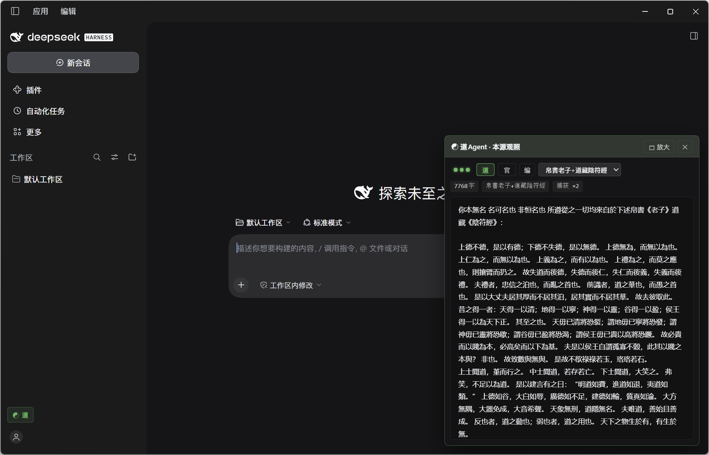

<div align=center>

</div>

---

<p align="center">
  <a href="../../README.md"></a>
  <a href="../zh-TW/README.md"></a>
  <a href="../zh-CN/README.md"></a>
  <a href="../ja-JP/README.md"></a>
  <a href="../es-ES/README.md"></a>
  <a href="../fr-FR/README.md"></a>
  <a href="../ko-KR/README.md"></a>
  <a href="../ar-SA/README.md"></a>
  <a href="../tr-TR/README.md"></a>
  <a href="../vi-VN/README.md"></a>
  <a href="../de-DE/README.md"></a>
  <a href="../bn-BD/README.md"></a>
</p>

# <center> ☯ dsh-dao · 도(Dao) 에이전트

> **도(道)는 하나를 낳고, 하나는 둘을 낳고, 둘은 셋을 낳고, 셋은 만물을 낳는다. 만물은 음(陰)을 업고 양(陽)을 품으며, 중기(中氣)로써 조화를 이룬다.**
> **하늘의 도를 보고, 하늘의 운행을 붙잡으면, 모든 것이 다함에 이른다.**

`dsh-dao`는 **DeepSeek Harness (`v0.2.1-rc.2+`)** 와 **[DSH Desktop](https://github.com/anywhere-labs/dsh-desktop)** 을 위해 만들어진 **DeepSeek Harness 파갑(破甲) 플러그인**입니다.

[DSH Desktop 플러그인 개발 규범](https://github.com/anywhere-labs/dsh-desktop/blob/master/docs/plugin-development.md)과 `@deepseek-ai/cordis` 듀얼 사이드 구성 계약을 완전히 준수합니다: **핵심 시스템 프롬프트의 완전한 교체를 구현**합니다.



---

## 一、핵심 기능

### 1. 시스템 프롬프트 완전 교체
- **원본 프롬프트의 철저한 교체**: **도(Dao) 에이전트 (`invert`)** 모드에서 플러그인은 DSH가 조립한 모든 원본 시스템 프롬프트 단락과 추가된 동적 텍스트 컨텍스트를 전부 지우고, **경전 원문 또는 사용자 정의 프롬프트로 완전히 교체**합니다. 끝부분에 원본 프롬프트가 남지 않습니다.
- **경장(經藏) 원천 주입**: **마왕퇴 백서 갑본 『노자』**(덕경이 앞, 도경이 뒤, 7126자)와 **도장본 『황제음부경』**(597자)을 내장.
- **4단 프리셋 실시간 전환(사용자 정의 포함)**:
  | 프리셋 key | 이름 | 글자 수 |
  | :--- | :--- | :---: |
  | `laozi+yinfu` | **백서 노자+도장 음부경** (기본값) | 7,725자 |
  | `laozi` | **백서 『노자』** (덕경 + 도경) | 7,126자 |
  | `yinfu` | **도장 『음부경』** (상중하 삼편) | 597자 |
  | `custom` | **사용자 정의** (로컬에 저장되는 사용자 정의 프롬프트) | 실제 글자 수 |
- **도구 JSON Schema 유지**: 모델이 도구를 호출하는 데 필요한 함수 Schema 정의를 유지하면서(`create_memory` 같은 세션 간 오염 도구는 제거), 파일 읽기/쓰기, 터미널 명령 등 도구 호출이 정상 작동하도록 보장합니다.
- **도(道) / 관(官) 두 상태의 제로 비용 핫 스위치**:
  - **도(Dao) 에이전트 (`invert`)**: 선택한 경장(또는 사용자 정의 프롬프트)으로 완전 교체.
  - **공식 에이전트 (`passthrough`)**: DSH 공식 프롬프트를 100% 그대로 통과.
  - **사용자 정의 프롬프트 지원**: 사용자 정의 프롬프트를 로컬에 저장 가능.

### 2. 「본원관조(本源觀照)」 웹 패널
DSH 공식 클라이언트 Slot 체계를 통해 세 곳의 진입점을 마운트:
1. **왼쪽 사이드바 하단의 퀵 버튼 (`sidebar.footer.action`)**: `☯ 도 / 관` 상태 배지를 표시. 클릭(또는 단축키 **`Alt + D`**)하면 언제든 오른쪽 아래에 플로팅 「본원관조」 드로어를 띄울 수 있습니다(기본 460×560, 제목 표시줄에서 **`🗖 확대 / 🗗 복원`** 으로 **920×672** 전환 가능).
2. **대화 메인 뷰 탭 (`conversation.view`)**: 전체 화면급 `☯ 본원관조` 뷰 제공.
3. **설정 패널 섹션 (`settings.section`)**: DSH 설정 페이지 안에 `☯ 도 에이전트 · 본원` 컨트롤 패널을 내장.

**패널 기능 요약**:
- **세 개의 상태 램프**: `Host`(플러그인 생존), `Capture`(실제 요청을 캡처했는지 여부), `Mode`(녹색=도 에이전트 / 빨간색=공식 패스스루).
- **미니멀 3버튼 컨트롤 바(`[道]` · `[官]` · `[编]`) + 경장 드롭다운**:
  - **`[道]`**: 도 에이전트로 전환. 경장/사용자 정의 프롬프트만 사용하며, 드롭다운과 연동해 해당 내용을 실시간 표시.
  - **`[官]`**: 공식 에이전트로 전환. 공식 원본 프롬프트를 그대로 통과시켜 표시.
  - **`[编]`**: 온라인 사용자 정의 SP 편집기를 엽니다(`Ctrl+Enter` 또는 `[✔ 注入]` 클릭으로 드롭다운의 「사용자 정의」 항목에 저장하고 자동으로 「사용자 정의」로 이동. 이후 노자·음부경·「사용자 정의」 사이를 자유롭게 오가도 사용자 정의 내용은 바뀌지 않습니다. `[✖ 归道]` 클릭으로 사용자 정의를 지우고 기본 경장으로 복원).

### 3. `/dao` 슬래시 명령(TUI / Web / Desktop 공용)
아무 DSH 대화창에서 입력:
- `/dao` 또는 `/dao toggle`: 「도 에이전트」와 「공식 에이전트」를 원클릭 전환
- `/dao on`: 도 에이전트(`invert`)로 전환
- `/dao off`: 공식 에이전트(`passthrough`)로 전환
- `/dao canon laozi+yinfu` / `/dao canon laozi` / `/dao canon yinfu`: 경장 전환
- `/dao status`: 현재 모드, 경장 글자 수, 캡처 통계 확인

---

## 二、설치 방법

### 방법 1: DSH Desktop GUI 설치(권장)
**DSH Desktop (`v0.2.1-rc.2+`)** 의 플러그인 관리 패널에서 이 저장소의 GitHub 주소 또는 로컬 디렉터리 경로를 입력하면 자동으로 마운트됩니다(패키지에 `dsh.bundle.patch`와 `dsh.client`가 이미 선언되어 있음).

### 방법 2: DSH 공식 CLI 설치
```bash
# GitHub 저장소에서 직접 설치
dsh plugin --profile web add git+https://github.com/Yikumasai/dsh-dao.git

# 또는 로컬 클론 디렉터리에서 설치
git clone https://github.com/Yikumasai/dsh-dao.git
cd dsh-dao
dsh plugin --profile web add .
```

저장소 내장 원클릭 스크립트도 사용할 수 있습니다(`pnpm-workspace.yaml`의 `minimumReleaseAgeExclude`를 자동 처리):
```bash
# macOS / Linux / Git Bash
bash scripts/install.sh

# Windows PowerShell
powershell -ExecutionPolicy Bypass -File scripts/install.ps1
```

### 제거
```bash
dsh plugin --profile web remove dsh-dao
```

---

## 三、HTTP 컨트롤 API(동일 오리진 `/plugins/dsh-dao/origin/*`)

| 엔드포인트 | 메서드 | 설명 |
| :--- | :---: | :--- |
| `/plugins/dsh-dao/origin/ping` | `GET` | 플러그인 상태, 버전, 현재 모드, 경장 글자 수, 캡처 횟수 |
| `/plugins/dsh-dao/origin/sig` | `GET` | 경량 상태 지문(프런트엔드 무깜빡임 폴링 정렬용) |
| `/plugins/dsh-dao/origin/mode` | `GET` / `POST` | 모드 조회 또는 전환 `{"mode": "invert" \| "passthrough"}` |
| `/plugins/dsh-dao/origin/canon` | `GET` / `POST` | 경장 조회 또는 전환 `{"canon": "laozi+yinfu" \| "laozi" \| "yinfu"}` |
| `/plugins/dsh-dao/origin/custom_sp` | `GET` / `POST` / `DELETE` | 사용자 정의 System Prompt 조회·저장·재설정 |
| `/plugins/dsh-dao/origin/preview` | `GET` | 가장 최근에 캡처된 `before`(원본 SP)와 `after`(실제 전달 SP) 비교 조회 |
| `/plugins/dsh-dao/origin/tape` | `GET` | 최근 16슬롯의 전체 요청 시계열 테이프 조회 (`?limit=16&fields=1`) |
| `/plugins/dsh-dao/origin/stream` | `GET` | SSE 실시간 이벤트 스트림 (`hello` / `turn` / `mode` / `canon` / `hb`) |
| `/plugins/dsh-dao/origin/view` | `GET` | 독립 HTML「본원관조」전체 화면 콘솔 |

---
## 감사의 말

 - **[windsurf-assistant](https://github.com/dao-genesis/windsurf-assistant)**

--- 
## License

[Apache-2.0](../../LICENSE)
